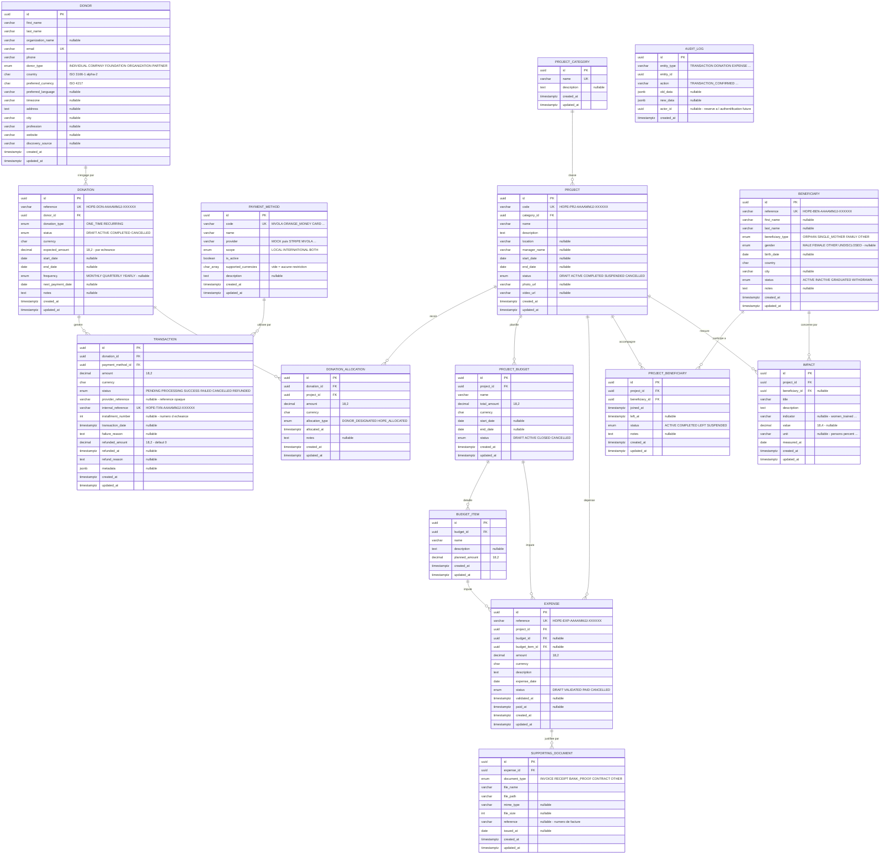
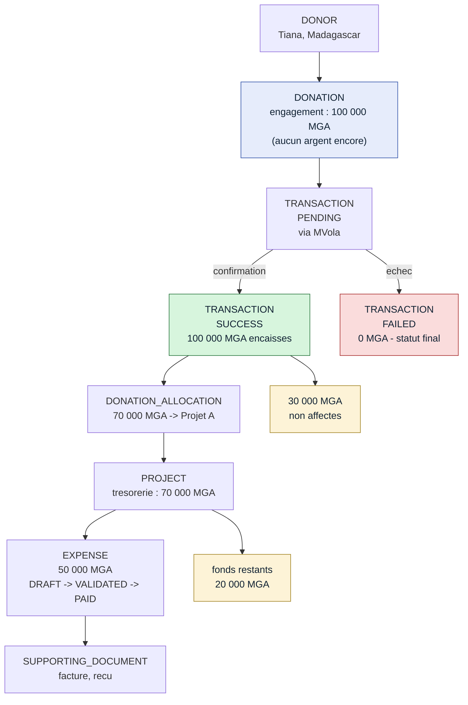
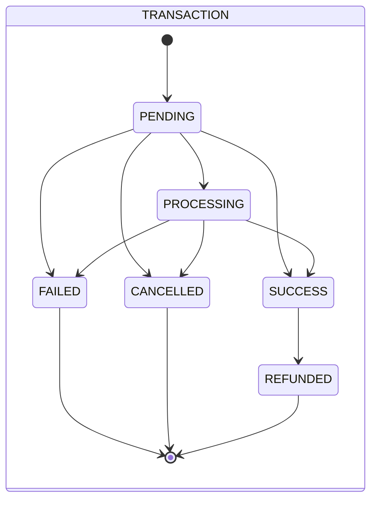
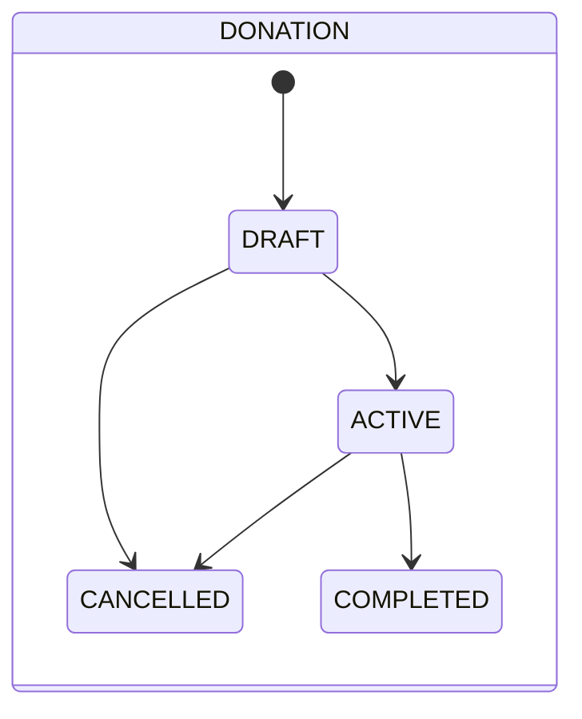
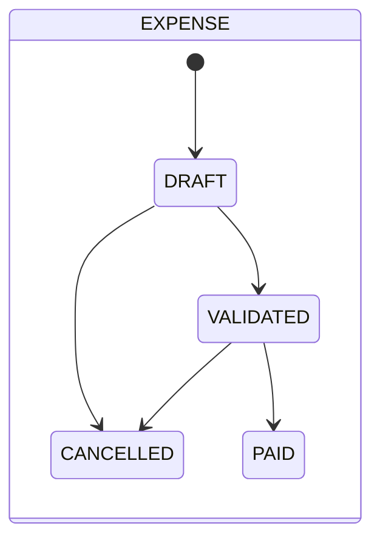
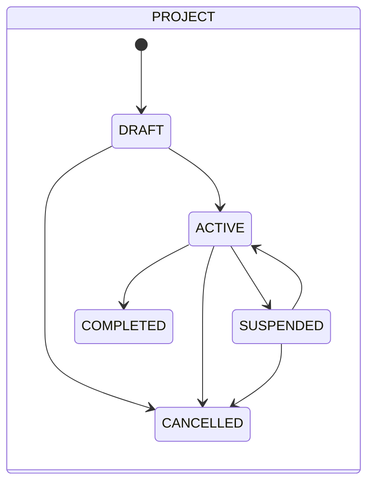

# HOPE — Diagramme entité-association

Base : `hope_donations` (PostgreSQL). 15 tables.
Description détaillée de chaque colonne : [`database.md`](database.md).

---

## Diagramme complet

> `AUDIT_LOG` n'a volontairement **aucune clé étrangère** : c'est un journal
> transverse qui référence n'importe quelle entité par le couple
> `(entity_type, entity_id)`, et qui doit survivre à ce qu'il trace.

---

## Le cœur financier

Le sous-ensemble à comprendre en premier : comment l'argent circule d'un donateur
jusqu'à une dépense justifiée.

**Points à retenir**

- entre `DONATION` et `TRANSACTION`, aucun argent n'existe encore ;
- seule la branche `SUCCESS` alimente les fonds : `FAILED` apporte 0 et reste dans
  l'historique ;
- `DONATION_ALLOCATION` ne peut jamais dépasser ce que `TRANSACTION` a réellement
  apporté ;
- `EXPENSE` est plafonnée à la fois par la trésorerie du projet **et** par le budget.

---

## Cycles de vie

`FAILED → SUCCESS` et `SUCCESS → CANCELLED` sont **absents du diagramme parce qu'ils
sont interdits** : une tentative échouée ne redevient jamais réussie, et de l'argent
encaissé se rembourse au lieu de s'annuler.

`PAID` est final : l'argent est sorti, une correction passe par une écriture
compensatoire.

